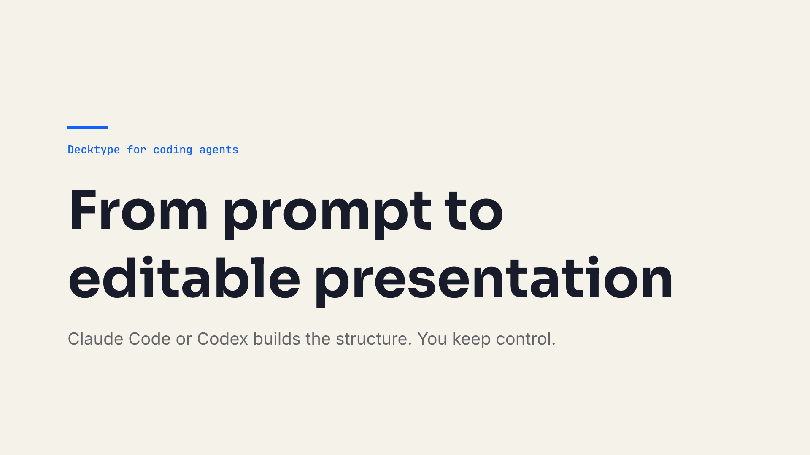

# Decktype Agent

Let Claude Code or Codex build your presentation, then keep editing it yourself as a native `.deck` file in Decktype, the presentation editor for Mac.

[Download Decktype for macOS](https://decktype.com/en/download?utm_source=github&utm_medium=plugin&utm_campaign=claude_code_plugin_launch) · [See pricing](https://decktype.com/en/pricing?utm_source=github&utm_medium=plugin&utm_campaign=claude_code_plugin_launch) · [Read the Claude Code PowerPoint tutorial](https://decktype.com/en/blog/claude-code-powerpoint?utm_source=github&utm_medium=plugin&utm_campaign=claude_code_plugin_launch)



## What it does

The plugin gives both agents the same workflow:

- agree on the audience and decision before generating slides;
- build with structured Decktype templates instead of flattened screenshots;
- preserve manual edits when the agent revises the content;
- import an existing PowerPoint file into an editable `.deck`;
- validate, lint, render, and inspect every changed slide;
- deliver an editable `.deck`, with an optional PDF or PowerPoint export.

## Who it is for

Consultants, founders, product and marketing teams who already work with Claude Code or Codex and need presentations they can still edit by hand: client proposals, reviews, reports, and training material.

## Requirements

- An Apple silicon Mac (M1 or newer) running macOS 11 Big Sur or newer.
- The [Decktype app](https://decktype.com/en/download?utm_source=github&utm_medium=plugin&utm_campaign=claude_code_plugin_launch), free to download.
- Claude Code or Codex.

After installing Decktype, open the app and choose **Connect an agent** once. This installs the local `deck` CLI that the plugin calls. Decktype does not add the CLI to your shell `PATH`; the skill does it for each agent session. To run the CLI yourself:

```sh
export PATH="$HOME/Library/Application Support/Decktype/bin:$PATH"
deck --version
```

## Plans

The plugin works on every Decktype plan. Prices from [decktype.com/en/pricing](https://decktype.com/en/pricing?utm_source=github&utm_medium=plugin&utm_campaign=claude_code_plugin_launch), which remains the reference:

| Plan | Price | What the plugin can deliver |
| --- | --- | --- |
| Free | €0 | Editable `.deck` files, PowerPoint import, PDF export with `deck pdf`, PNG previews |
| Pro | €12 / month incl. VAT | Everything in Free, plus Keynote-compatible PowerPoint export with `deck export` |
| Autonomous | €29 / month incl. VAT | Everything in Pro, plus the assistant built into the Decktype app |

Without a signed-in Pro or Autonomous plan, `deck export` refuses to write a `.pptx`; the skill then tells you why and delivers the `.deck` and a PDF instead.

## Install in Claude Code

```sh
claude plugin marketplace add Tontoon7/decktype-agent
claude plugin install decktype@decktype-agent
```

Start a new Claude Code session, or run `/reload-plugins` if the installer asks you to reload.

## Install in Codex

```sh
codex plugin marketplace add Tontoon7/decktype-agent
codex plugin add decktype@decktype-agent
```

Start a new Codex session after installation.

## Use it

Ask naturally. The `decktype` skill activates when the request needs an editable presentation or a `.deck` file.

```text
Create an editable 7-slide presentation for a product review.
Audience: the leadership team.
Decision: approve a two-week pilot.
Use only facts from brief.md, show me the outline before generating,
and export a PowerPoint after I approve the rendered deck.
```

For an existing presentation:

```text
Revise customer-review.deck with the new priorities in notes.md.
Keep my manual layout changes, render every modified slide,
and show me the result before exporting.
```

To share a read-only version:

```text
Render quarterly-review.deck, check every slide,
then export it to PDF for the board.
```

## Example

The repository includes a real four-slide presentation built with the standard template pack:

- [Open or download the editable `.deck`](plugins/decktype/examples/agent-workflow.deck)
- [Title](plugins/decktype/examples/slide-01.png)
- [Thesis](plugins/decktype/examples/slide-02.png)
- [Workflow](plugins/decktype/examples/slide-03.png)
- [Next step](plugins/decktype/examples/slide-04.png)

## What is public

This repository contains only the agent workflow, plugin manifests, references, tests, and example assets. The Decktype application source is not part of the plugin.

The plugin does not add hooks, background services, an MCP server, or bundled executables. It calls the local `deck` CLI installed through Decktype and works on files the user places in scope. It cites only public `deck` commands, listed in [tests/fixtures/deck-cli-1.3.2.json](tests/fixtures/deck-cli-1.3.2.json).

## Compatibility

Tested with the `deck` CLI 1.3.2 shipped with Decktype 1.3.2. PDF export needs `deck` 1.3.2 or newer: update Decktype and choose **Connect an agent** again if `deck pdf --help` fails.

## Validate the repository

```sh
python3 -m unittest discover -s tests
claude plugin validate --strict plugins/decktype
claude plugin validate --strict .
```

The release tests check that every cited `deck` command and option exists in the published CLI, and validate the example bundle with the installed `deck` CLI.

## Learn more

- [Decktype for AI agents](https://decktype.com/en/agents?utm_source=github&utm_medium=plugin&utm_campaign=claude_code_plugin_launch): connect Claude Code or Codex, and what to do if the CLI is not detected.
- [Claude Code PowerPoint: Build Editable Presentations with Decktype](https://decktype.com/en/blog/claude-code-powerpoint?utm_source=github&utm_medium=plugin&utm_campaign=claude_code_plugin_launch): the complete workflow.
- [Getting started with the deck CLI](https://decktype.com/en/blog/deck-cli-getting-started?utm_source=github&utm_medium=plugin&utm_campaign=claude_code_plugin_launch).
- [Privacy](https://decktype.com/en/privacy) · [Terms](https://decktype.com/en/terms)

## License

MIT. See [LICENSE](LICENSE).
