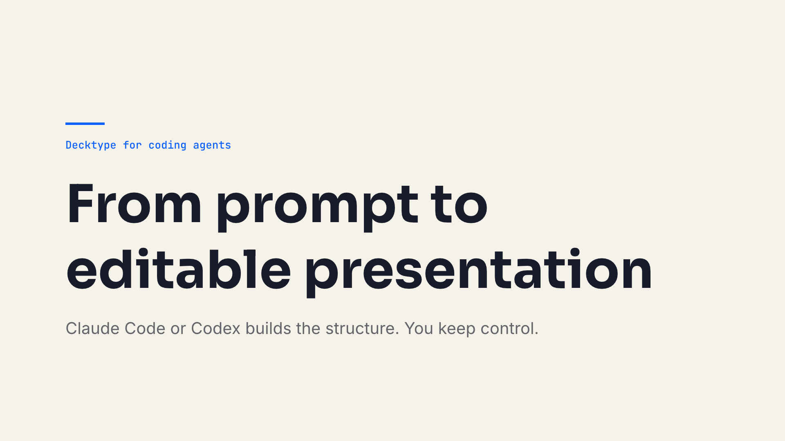

# Decktype for Claude

Ask Claude for a presentation and get an editable deck in Decktype, not a static file. Claude agrees on the audience and the decision with you, builds each slide from Decktype templates, checks the result, and gives you a private link to finish the deck in the Decktype editor. When Claude revises it later, your manual retouches are kept.

## What it contains

- The **Decktype connector**, a remote MCP server at `https://api.decktype.com/mcp`. You connect it once from the plugin's **Connectors** tab and sign in with your Decktype account.
- The **decktype-cloud skill**, which tells Claude how to use it: settle the story first, prefer the premium templates, preview dense slides before delivering, revise with the current revision, and update recurring reports in place.

It works in Claude chat, Cowork, and Claude Code, with no app to install. To build `.deck` files locally on a Mac with the `deck` command, use the `decktype` plugin from the same repository instead.

## Example prompts

- Prepare a 6-slide proposal for the steering committee from these notes, and show me the outline first.
- Update last month's sales report deck with the figures in this table.
- Show me slide 3 of my quarterly review and shorten its text.

## Data and privacy

Presentations are created and stored in your private Decktype Cloud workspace. The plugin adds no hooks, no local server, and no executable. Plans: [decktype.com/en/pricing](https://decktype.com/en/pricing). Privacy policy: [decktype.com/en/privacy](https://decktype.com/en/privacy).

## License

MIT
